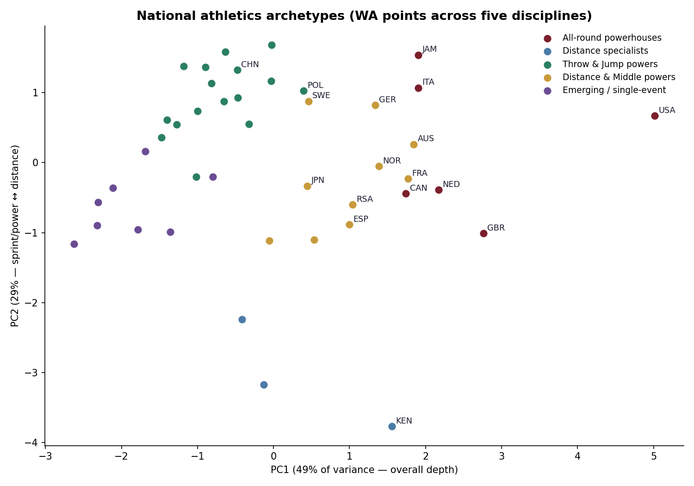
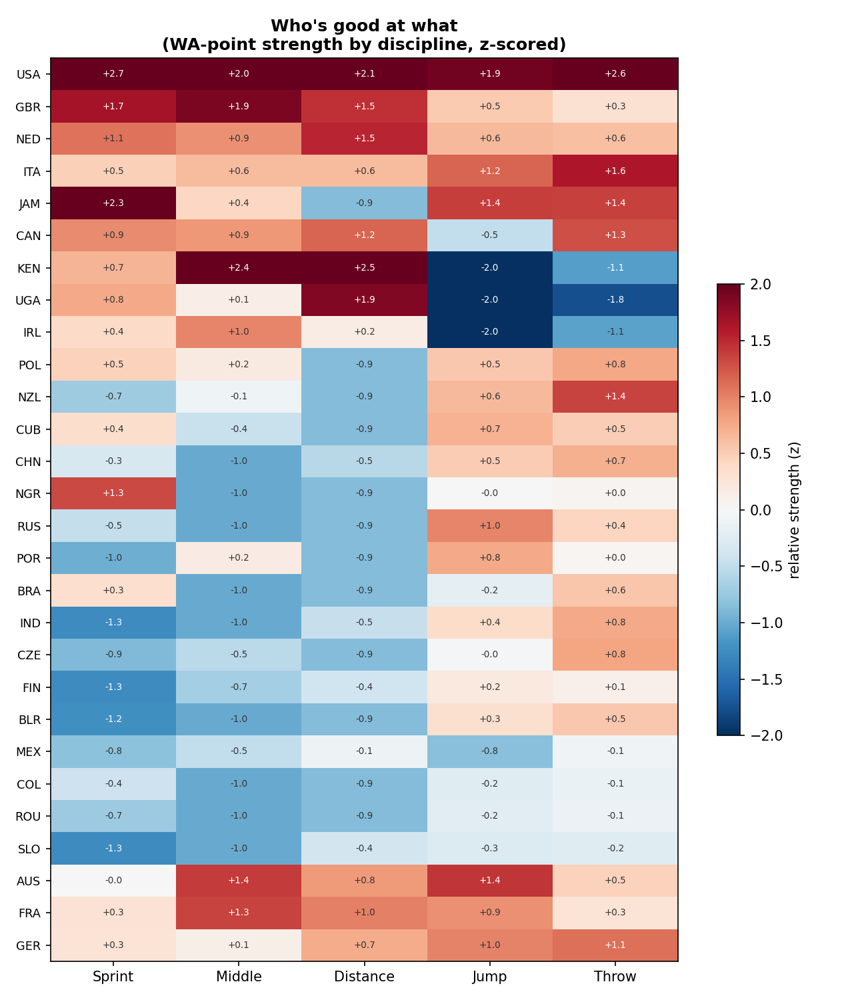
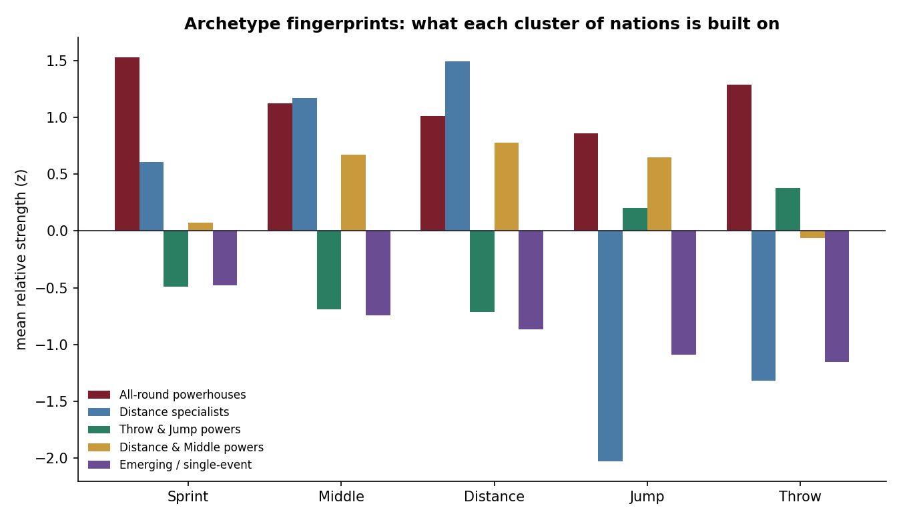

# National Strength Profiles — Who's Good at What

*Medal tables are a blunt instrument. With WA points as a currency, you can see the whole shape of a nation's athletic strength — and cluster the world by it.*

## Beyond the medal table

A medal count tells you a country won three golds. It doesn't tell you whether that
country is a narrow specialist or a broad machine, whether its strength is sprinting
or throwing, or how it stacks up in the 99% of world-class performances that never
touch a podium. World Athletics points fix that: they put every performance, in every
event, on one comparable scale. So I used them as a **currency of athletic capital**.

From **6,400 top performances** (16 events, both genders, 2023–24, each tagged with a
nationality and its WA score) I built a **country × discipline** matrix — each cell a
nation's mean top-5 score in one of five discipline groups. Then I let the data sort
the nations out for itself, with **k-means clustering** and a **PCA** map.

## Five archetypes fall out cleanly

  

The clusters are exactly the ones a fan would name, now drawn from data:

- **All-round powerhouses** — the USA, GB, the Netherlands, Italy, Jamaica, Canada.
  And the USA is not just in this group, it *towers* over it: on the depth axis it sits
  a full principal-component-unit beyond anyone else. It is the sport's one true
  superpower.
- **Distance specialists** — Kenya and Uganda, elite over 1500 m to the marathon and
  pointedly narrow everywhere else. Kenya anchors the entire distance pole of the map.
- **Throw & jump powers** — Poland, China, Cuba, Nigeria: nations whose athletic
  capital is banked in the field, not on the track.
- **Distance & middle powers** — Australia, France, Germany, Norway, Japan, Spain:
  broad, well-funded programmes with an endurance tilt.
- **Emerging / single-event nations** — a Bahamas built on the 400 m, a Trinidad on the
  sprints: real world-class presence, in one lane.

  

## What the axes mean

The two principal components are interpretable, which is the tell that the structure
is real and not an artefact. **PC1 (49% of the variance) is overall depth** — how much
world-class strength a nation has, full stop; it runs from the emerging nations up to
the USA. **PC2 (29%) is a sprint-and-power ↔ distance axis** — Kenya sits at one
extreme, the throws-and-jumps nations at the other, and the balanced programmes in
between.

  

Each cluster has a *fingerprint*: the throw-and-jump powers spike in the field and sag
on the track; the distance specialists are the mirror image; the all-rounders are
strong everywhere. It's the national character of a track programme, made legible.

## Where this goes next

The matrix here is *absolute* strength. Divide it by population or GDP and a different,
equally interesting map appears — the **overperformers**, the Jamaicas and Norways that
punch far above their size. That per-capita layer sits directly on top of this one, and
is the natural next chapter.

*Code: [github.com/lyhjeremy/national-strength-profiles](https://github.com/lyhjeremy/national-strength-profiles)*
